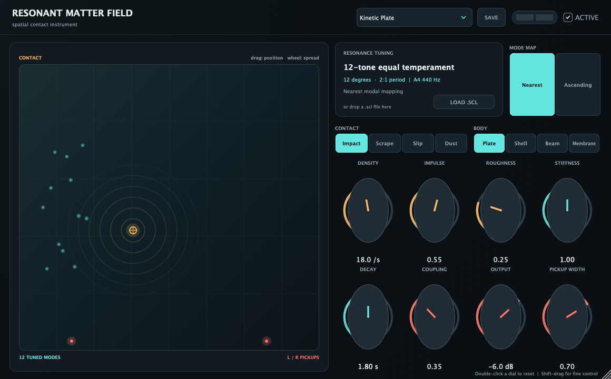
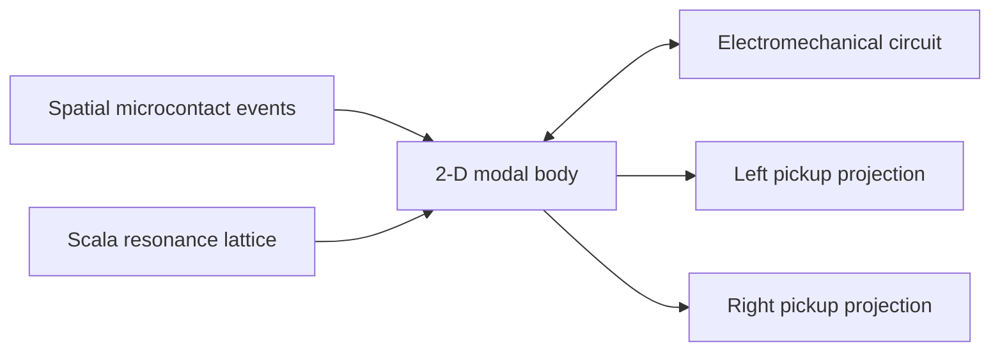

# Resonant Matter Field

**A spatial microcontact, modal, and electromechanical synthesizer for macOS AU and VST3.**



Resonant Matter Field (RMF) sits between granular synthesis and physical modeling. Its “grains” are not slices of recorded audio: they are microscopic force events—impacts, slips, scrapes, fractures, and particulate contacts—placed inside a modeled resonant body. The body exchanges energy with a simplified electromechanical transducer and is observed from two spatially separated pickup positions.

The result is a playable instrument whose stereo image emerges from contact location, mode shapes, body propagation, and pickup geometry rather than post-panning.

## Download

The easiest way to use RMF is the prebuilt Apple-silicon package on the [latest GitHub Release](https://github.com/mark-renker/resonant-matter-field/releases/latest). It contains:

- arm64 AU and VST3 instruments
- 24 factory sounds
- Scala tunings
- WAV, M4A, and MP3 demonstrations
- complete source and verification scripts

The supplied v1.0 binaries are ad-hoc signed for local use. They are **not** Developer ID-notarized retail binaries.

### Install on macOS

From the downloaded release, run:

```sh
./scripts/install_macos.sh
```

Or copy the bundles manually:

```text
Binaries/Resonant Matter Field.vst3
  → ~/Library/Audio/Plug-Ins/VST3/

Binaries/Resonant Matter Field.component
  → ~/Library/Audio/Plug-Ins/Components/
```

On Ableton Live's next normal launch, look under **Plug-ins → VST3 → Resonant Matter Lab → Resonant Matter Field**. The AU appears under **Audio Units** when AU support is enabled. If necessary, use Live's plug-in rescan once after reopening it.

To uninstall, quit audio hosts and remove only those two named bundles.

## What makes RMF different



Each event has a location, duration, force, roughness, and population spread. It excites every body mode according to the local mode shape. A compact R/L/BL circuit proxy models drive current, back-EMF, electrical loading, inductance, and bounded active reinforcement. Separate pickup projections read the same body at different nodal positions.

This produces five broad families without samples or an effects rack:

- sparse struck and fractured bodies
- continuous friction and adhesive slip
- dense particulate fields
- sustained or near-unstable electromechanical blooms
- microtonal and non-octave resonance constellations

## Main capabilities

- 12-voice polyphony with sample-accurate MIDI events
- up to 32 two-dimensional resonant modes per voice
- four overlapping Poisson microcontact slots per voice
- independent left/right modal pickup projections
- runtime Scala `.scl` loading by picker or drag-and-drop
- cents, ratios, comments, arbitrary degree counts, and non-octave periods
- geometry-preserving **Nearest** and direct-lattice **Ascending** resonance mappings
- embedded tuning text for host-state recovery when the original file disappears
- 25 ms parameter smoothing, DC blocking, state clamps, and bounded output saturation
- velocity, sustain, ±2-semitone pitch bend, CC1, and channel/poly pressure response
- resizable JUCE interface with typed values, fine adjustment, reset, tooltips, meters, and an interactive contact field

## Five-minute tour

1. Load **Kinetic Plate** and play a note or chord.
2. Drag the amber contact target through the field. Moving across nodal lines changes both timbre and stereo projection.
3. Use the field's mouse wheel to increase the event-position spread.
4. Move from **Impact** toward **Scrape** or **Dust**, then refine Density, Impulse, and Roughness.
5. Load [`Tunings/bohlen_pierce_13edt.scl`](Tunings/bohlen_pierce_13edt.scl). Compare **Nearest** with **Ascending**; the 3:1 period makes the modal lattice audibly non-octave.
6. Try **Active Coil Bloom** and raise Coupling to hear the body move toward controlled electromechanical reinforcement.

## Controls

### Microcontacts

- **Density** — average Poisson event rate per second.
- **Impulse** — force delivered by each contact.
- **Roughness** — irregularity inside each micro-slip.
- **Field target** — contact position inside the body.
- **Field wheel** — event-position spread around that target.
- **Impact / Scrape / Slip / Dust** — coherent performance macros, not samples.

### Material body

- **Stiffness** — global mode-frequency scaling.
- **Decay** — mechanical energy-loss time.
- **Plate / Shell / Beam / Membrane** — body-character macros.
- Host automation also exposes anisotropy, dispersion, mode count, trajectory depth/rate, and contact duration.

### Transducer and output

- **Coupling** — strength of the force/current/back-EMF relationship.
- **Electrical Loading** — circuit loss reflected into the mechanical body.
- **Inductance** — coil-current time constant and high-frequency behavior.
- **Active Impedance** — bounded reinforcement approaching near-instability.
- **Pickup Width** — separation between the two modal observation points.
- **Output** — final gain before DC blocking and safety saturation.

### Performance MIDI

- Velocity scales contact energy.
- Mod wheel (CC1) adds roughness and contact-field motion.
- Channel pressure and poly aftertouch add contact force and BL coupling.
- Pitch bend moves the complete modal field over ±2 semitones.
- Sustain pedal (CC64) holds resonant tails.

## Microtonal resonance mapping

RMF applies Scala tuning to the **resonant spectrum**, not only MIDI notes. The interface shows the scale name, period, degree count, mapping mode, tuned modes, and the A4 = 440 Hz reference.

- **Natural** leaves the geometric modal ratios untouched.
- **Nearest** snaps each physical mode to the closest frequency in the loaded tuning lattice.
- **Ascending** assigns successive modes directly to successive scale degrees.
- **Scale Degree Spread** skips degrees to create more open constellations.

Included tunings:

- [19-EDO](Tunings/19edo.scl)
- [five-limit just intonation](Tunings/just_major.scl)
- [13-EDT Bohlen–Pierce](Tunings/bohlen_pierce_13edt.scl), repeating at a 3:1 tritave

`.kbm` keyboard maps are not supported in v1.0.

## Audio examples

All examples are dry, stereo, 48 kHz engine-direct renders with no reverb, delay, chorus, or mastering chain.

| Scene | Tuning / behavior | M4A | MP3 |
|---|---|---|---|
| Sparse Alloy | 19-EDO, isolated long-decay contacts | [play](AudioExamples/01_19edo_sparse_alloy.m4a) | [play](AudioExamples/01_19edo_sparse_alloy.mp3) |
| Friction Cloud | five-limit JI, continuous rough contact | [play](AudioExamples/02_just_friction_cloud.m4a) | [play](AudioExamples/02_just_friction_cloud.mp3) |
| Bohlen–Pierce Constellation | 13-EDT, non-octave 3:1 period | [play](AudioExamples/03_bohlen_pierce_constellation.m4a) | [play](AudioExamples/03_bohlen_pierce_constellation.mp3) |
| Active Coil Bloom | bounded active electromechanical reinforcement | [play](AudioExamples/04_active_coil_bloom.m4a) | [play](AudioExamples/04_active_coil_bloom.mp3) |
| Audition reel | all four scenes | [play](AudioExamples/RMF_Audition_Reel.m4a) | [play](AudioExamples/RMF_Audition_Reel.mp3) |

See [the factory-sound map](docs/FACTORY_SOUNDS.md) and [audio-example notes](docs/AUDIO_EXAMPLES.md).

## Build from source

Requirements:

- macOS 12 or later
- Xcode command-line tools
- CMake 3.22+
- JUCE 8

JUCE is not vendored. Either place it at `vendor/JUCE`, install it at `/Applications/JUCE`, or provide its location explicitly:

```sh
cmake -S . -B build -G "Unix Makefiles" \
  -DJUCE_ROOT=/path/to/JUCE \
  -DCMAKE_BUILD_TYPE=Release
cmake --build build -j 4
ctest --test-dir build --output-on-failure
```

The helper script uses `/Applications/JUCE` by default:

```sh
JUCE_ROOT=/path/to/JUCE ./scripts/build_macos.sh
```

Validate the reduced Faust companion with:

```sh
faust -lang cpp -o /tmp/rmf_faust.cpp faust/resonant_matter_field.dsp
```

## Validation

The release build was checked as native arm64 and passed deep strict signature verification. Apple's `auval` completed successfully, including MIDI, custom UI, all 24 factory programs, 25 parameters, parameter persistence, render slicing, and sample-rate renders from 11.025 through 192 kHz.

Automated tests cover:

- Scala parsing and malformed-input rejection
- 19-EDO and non-octave Bohlen–Pierce lattice calculations
- audible and finite DSP output
- maximum 12-voice / 32-mode / 400-event-per-second active-impedance stress
- embedded Scala recovery after deleting the original tuning file

See [the detailed quality report](docs/QUALITY_REPORT.md). Ableton discovery and Live Set reopen remain host checks to perform after installing a release; they are not inferred from a bundle merely existing on disk.

## Repository layout

```text
Source/          JUCE processor, editor, Scala parser, and RMF engine
Tests/           Scala/DSP and embedded-state recovery tests
Tools/           Headless demo renderer
Tunings/         Included Scala files
faust/           Reduced, validated Faust companion
AudioExamples/   Phone-playable dry demonstrations
scripts/         Build, install, and verification helpers
docs/            Interface, sound map, and validation notes
```

## Known limitations

- The v1.0 release binaries are arm64 only.
- No `.kbm`, MPE per-note expression, seedable random-state recall, or effects rack.
- Factory body/contact buttons are macros whose underlying parameters save and automate; button highlights are not separate host parameters.
- The electromechanical circuit is a musically useful bounded approximation, not a bit-exact transducer simulation.
- No standalone Steinberg VST3-validator result is claimed for v1.0.

## Contributing and license

Issues and focused pull requests are welcome; please read [CONTRIBUTING.md](CONTRIBUTING.md). Security-sensitive reports should follow [SECURITY.md](SECURITY.md).

RMF source is released under the [MIT License](LICENSE). JUCE is not part of that grant and remains subject to [JUCE's own license](https://juce.com/legal/juce-8-licence/).
